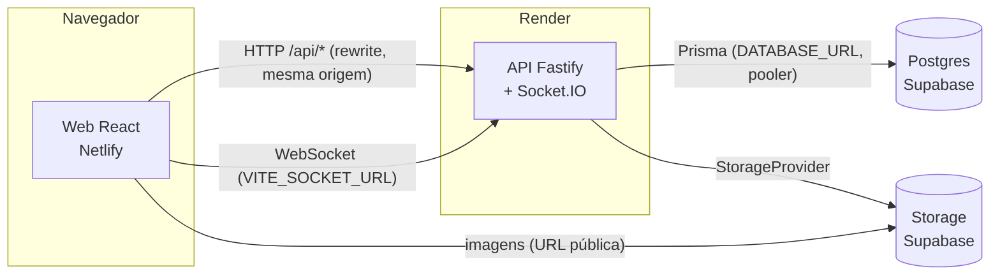
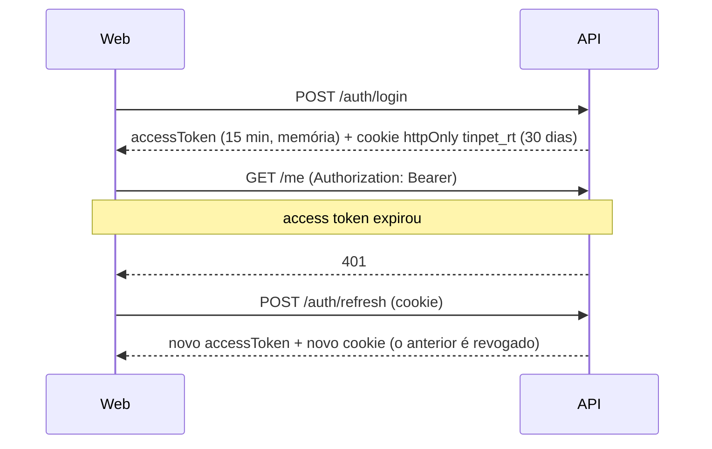
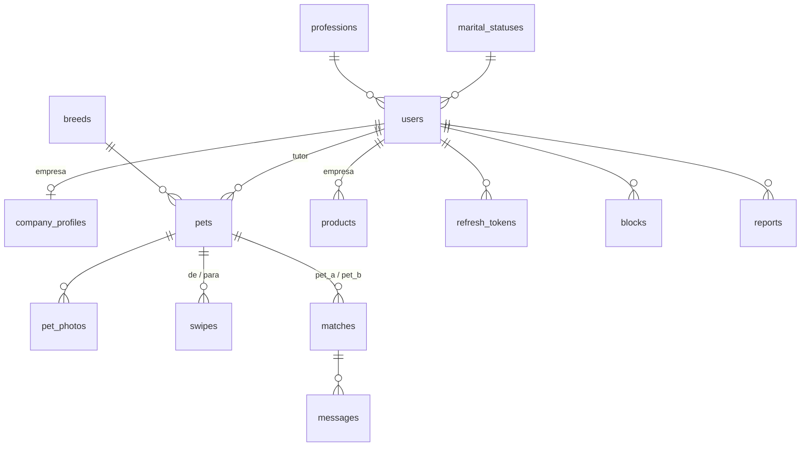

# Arquitetura

## Visão geral

Na VPS o desenho é o mesmo trocando os provedores: Caddy na frente, Postgres e storage S3 (RustFS) em containers ([deploy-vps.md](deploy-vps.md)).

**Princípio central:** toda regra de negócio está na nossa API. O Supabase é só Postgres + armazenamento de arquivos ([ADR 0001](adr/0001-supabase-so-postgres-e-storage.md)), então migrar para uma VPS é trocar variáveis de ambiente.

## Pacotes

| Pacote | Responsabilidade |
|---|---|
| `packages/shared` | Contratos: schemas Zod de entrada e saída, enums, rótulos em português, regra de compatibilidade de pets. Usado pela API (validação e serialização) e pelo web (formulários e tipos). |
| `apps/api` | HTTP + Socket.IO. `src/modules/<feature>/{routes,service}.ts`, infraestrutura em `src/shared`. `app.ts` monta o servidor sem abrir porta (testes usam `app.inject`). |
| `apps/web` | SPA React. `src/features/<feature>` com as telas, `src/lib` com cliente HTTP, sessão, socket e utilitários. |

## Fluxos principais

### Autenticação

O refresh token é opaco, guardado como hash SHA-256 e rotacionado a cada uso. Reapresentar um token já rotacionado (fora de uma janela de 30 s para requisições simultâneas) revoga a família inteira de sessões: sinal de roubo. Detalhes no [ADR 0005](adr/0005-autenticacao.md).

### Feed, swipe e match

1. `GET /feed?petId=` devolve pets **ativos**, de **outros tutores**, da **mesma espécie**, com **objetivo compatível** (amizade combina com qualquer sexo; cruzamento exige sexo oposto), **ainda não avaliados** e **sem bloqueio** entre os tutores.
2. A ordem é por distância entre os tutores (Haversine em SQL, [ADR 0004](adr/0004-distancia-haversine.md)), com paginação por cursor `(distância, id)`.
3. `POST /swipes` grava o swipe e, se for LIKE, verifica na **mesma transação** se existe LIKE recíproco. Um `pg_advisory_xact_lock` por par de pets serializa likes simultâneos, então sai exatamente um match.
4. O outro tutor recebe `match:new` via Socket.IO.

### Chat

Só participantes de um match ativo (sem unmatch nem bloqueio) leem e enviam mensagens. O envio usa Socket.IO com confirmação (ack) e cai para `POST /matches/:id/messages` se o socket não responder. O histórico é paginado por cursor, do mais recente para o mais antigo.

## Modelo de dados

- IDs `uuid` (não expõem volume nem são sequenciais).
- Exclusão de conta é **real** (cascata), como pede a LGPD; pets e produtos usam `is_active` para esconder sem apagar. Denúncias mantêm o registro com `reporter_id` nulo.
- Restrições no banco: `pet_a_id < pet_b_id` em matches, swipe único por par, preço não negativo.
- Diferenças em relação ao MER original ([docs/notion](notion/documentacao.md)): `Anunciante` virou `company_profiles` (1:1 com o usuário), `Anuncio` + `Item_do_Mercado` viraram `products`, `Combinacao` virou `swipes` + `matches`. Os contadores (`contador_curtida`) são calculados por consulta. Postagens/ações sociais ficaram fora do MVP ([backlog](backlog.md)).

## Segurança

- Validação Zod em toda entrada e saída; erros padronizados sem stack trace.
- Helmet, CORS restrito por `CORS_ORIGINS`, rate limit global (300/min) e mais rígido em login/cadastro (10/min por IP).
- argon2id para senhas; logs com `authorization`, `cookie` e `set-cookie` ocultados.
- Uploads validados pelo conteúdo (sharp), redimensionados, reconvertidos para WebP e sem metadados.

## Preparado para o futuro (não implementado)

- **App mobile:** os contratos já estão em `packages/shared`; o React Native consome a mesma API (o access token vai no header; o refresh pode ser enviado no corpo numa rota própria para mobile).
- **Saúde do pet / dog walker:** novos módulos em `apps/api/src/modules` com tabelas ligadas a `pets`/`users`, sem tocar no núcleo.
- **Esqueci minha senha:** reaproveita `newOpaqueToken`/`hashToken` (`shared/auth.ts`) numa tabela `password_reset_tokens` com expiração curta, mais o envio de e-mail.
