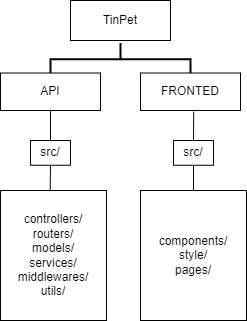
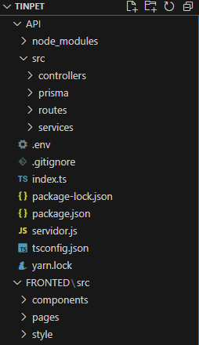
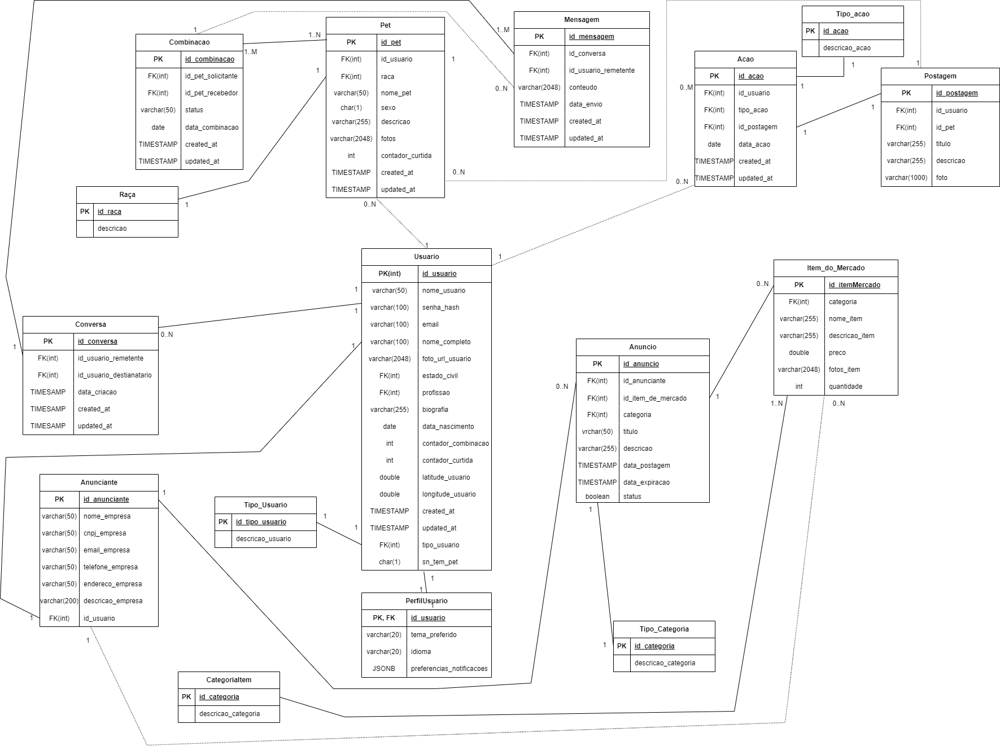

# DOCUMENTAÇÃO TinPet/PetMigo/PetMatch/petmate/PetDrugs/BeerPetch

**OBJETIVO:** O objetivo é desenvolver uma aplicação (sistema) web que sirva como um tinder para pets de estimação. A aplicação deve ter tela de login/cadastro, um feed de fotos de animais de estimação onde os donos de pet vão poder dar match com outros animais de estimação que se agradarem para serem par dos seus bichinhos e um marketplace onde as empresas vão poder anunciar seus itens de venda, como ração de cachorro e acessórios para pets.

Além disso, o usuário dono do Pet, terá uma seção de perfil onde pode colocar algumas informações de si para que caso o outro dono de pet queira descobrir um pouco mais sobre o dono daquele pet ele possa saber como algumas informações sobre estado civil, idade, profissão, uma biografia e uma foto para saber qual o rosto da pessoa.

**SITE**: https://bem-vindo-a-tinpet-bda8zc7.gamma.site/

**SLIDE:** https://gamma.app/docs/Bem-vindo-a-TinPet-bb4ebvcrb4occtl?mode=doc#card-2dsqirgzchbbffi
**DRAW.IO:** https://drive.google.com/file/d/1_9bD-VqtutLaFI5Ltn3lSVCnL0Q2PN26/view?usp=sharing
**FIGMA:** https://www.figma.com/design/dtrh08tlFvbaLHYKUw9E7g/Tinpet?node-id=0-1&t=my8lbiVTXbzR2MOZ-1
**GITHUB:** https://github.com/Wesley-Silva-hub/TInPet?tab=readme-ov-file

## **TECNOLOGIAS**

Rodando o projeto: Dentro da pasta API, dê o comando npm install, depois: 

npx prisma generate,
depois: 

- Configure o banco de dados utilizando Prisma:
    - Gere o cliente Prisma:
        
        ```bash
        bashCopiar código
        npx prisma generate
        
        ```
        
    - Crie as tabelas no banco de dados:
        
        ```bash
        bashCopiar código
        npx prisma db push
        
        ```
        
    - Se houver migrações, aplique-as:
        
        ```bash
        bashCopiar código
        npx prisma migrate dev --name init
        
        ```
        
- Inicie o servidor:
    
    ```bash
    bashCopiar código
    npm start
    
    ```
    

## ESTRUTURA DO PROJETO





Passo a passo:

Dentro de API, dê o comando npm init -y para criar um projeto node.
Para istalar as bibliotecas que vão ser usadas: yarn add expresss nodemon cors (adicionar em package.json a linha start: “nodemon servidor.js”
Se der um erro de importação saiba que pode ser o tipo de modulo: 
Esse erro ocorre porque você está tentando usar a sintaxe de importação ES6 (`import`) em um ambiente Node.js que não está configurado para suportar módulos ES. Por padrão, o Node.js usa o sistema de módulos CommonJS (`require`).
O express é para a fazer a API, o nodemon para nao precisar parar e startar o serviço e o cors é para nao dar problema ao rodar localmente. Se tiver usando o windows (powershell) e der erro de permissao, rode: Set-ExecutionPolicy RemoteSigned -Scope CurrentUser.
Crie um arquivo index.js para servir como servidor. Configure o package.json para rodar o nodemon index.js sempre que tiver alteração.

## ROTAS API

/usuarios → traz todos os usuarios

/profissoes → traz todas as profissoes

### **1. Sistema Web Desktop e Site (Frontend)

Passo a passo:**

Para inicializar o frontend, damos o comando: npx create-react-app ./ para criar uma aplicacao bascica em javascript para economizar tempo com coisas básicas.
Depois:  yarn add styled-components axios react-icons react-toastify

Depis de excluir o que nao seria util, apenas deixando app.js, index.js e index.html, foi-se no google fonts e pegou-se a fonte poppins. 

### **Opções de Frameworks:**

- **React.js**:
    - Um framework JavaScript popular para construir interfaces de usuário. React permite criar componentes reutilizáveis e gerenciar o estado do aplicativo de forma eficiente.
- **Next.js**:
    - Um framework que expande o React com recursos como renderização do lado do servidor (SSR) e geração estática de páginas. Isso melhora o desempenho e o SEO do seu site.

### **2. Aplicativo Mobile (Frontend)**

### **Opções de Frameworks:**

- **React Native**:
    - Permite que você use React e JavaScript para criar aplicativos móveis nativos para iOS e Android. Ele fornece componentes que mapeiam para elementos nativos, garantindo um desempenho próximo ao nativo.

Sim, se você escolher JavaScript, pode usá-lo para desenvolver todas as partes do seu projeto, incluindo o sistema web desktop, o site, o aplicativo mobile, o backend e o frontend. Aqui estão as tecnologias JavaScript que você pode usar para cada componente do seu projeto:

### **3. Backend (Servidor)**

### **Opções de Frameworks:**

- **Node.js** com **Express.js**:
    - Uma das combinações mais populares para criar servidores web. Express.js é um framework minimalista que facilita a criação de APIs RESTful.
- **NestJS**:
    - Um framework de desenvolvimento progressivo para Node.js que usa conceitos do Angular, como injeção de dependência e arquitetura modular. É adequado para aplicativos grandes e complexos.

Para inicializar o projeto vamos usar o PRISMA que facilita na abstração do banco de dados para a aplicação; O Prisma é uma ferramenta moderna de ORM (Object-Relational Mapping) que facilita o desenvolvimento de aplicações com banco de dados. Ele abstrai as interações com o banco de dados, permitindo que você trabalhe com o banco de dados de forma mais intuitiva e produtiva, utilizando um modelo de dados que se integra bem com a linguagem de programação que você está utilizando, como JavaScript ou TypeScript.
Utilizamos o tutorial: https://www.prisma.io/docs/getting-started/setup-prisma/start-from-scratch/relational-databases-typescript-postgresql

Aém disso, utilizamos o video: https://www.youtube.com/watch?v=QXxy8Uv1LnQ
Api e Fronted: https://www.youtube.com/watch?v=voXTVTW73E8
API com PRISMA e DOCKER: https://www.youtube.com/watch?v=gnq8ZY85UUM

Mini Tutorial:

Nosso projeto terá o seguinte formato: API e BACKEND

Para criar as tabelas a primeira vez voce deve dar o comando: npx prisma db push

Sempre que mudar algo no schema.prisma, rodar o comando: npx prisma migrate dev --name nome_da_mudanca

Depois dar um: npx prisma generate, para fazer as alterações feitas valerem.
Após isso, só rodar o comando: npx ts-node nome_arquivo.ts

### **4. Comunicação API**

- **REST API**:
    - Um padrão de arquitetura amplamente utilizado para construir serviços web. É fácil de implementar e suporta métodos HTTP como GET, POST, PUT e DELETE.

# **BANCO DE DADOS**

1. **PostgreSQL**
    - Um banco de dados relacional robusto e escalável, com suporte a consultas complexas e alta consistência.
    - Pode ser usado em conjunto com soluções de cache como **Redis** para melhorar ainda mais o desempenho.

### **Modelo Entidade-Relacionamento**



Houve algumas alterações do MER para o código na aplicação, foi-se adicionado uma coluna deletedAt           DateTime?, que é armazenada com NULL e quando for deletado essa coluna é atualizada com a data do momento, isto é, quando o campo for NULL, ele está ativo e quando tiver preenchido, o registro foi apagado.

# **HOSPEDAGEM E SERVIÇOS**

Kubernetes com Docker

**AWS** ou **Google Cloud Platform (GCP)**

- Essas plataformas oferecem uma ampla gama de serviços gerenciados que podem ser escalados automaticamente de acordo com a demanda, incluindo **EC2** (AWS) ou **Compute Engine** (GCP) para hospedagem de servidores, e **Elastic Beanstalk** (AWS) ou **App Engine** (GCP) para aplicações web.
- Docker permite a criação de contêineres que encapsulam o ambiente de execução do seu aplicativo, garantindo consistência e isolamento.
- Kubernetes é uma plataforma de orquestração de contêineres que automatiza o gerenciamento de aplicativos distribuídos, permitindo escalabilidade horizontal e balanceamento de carga.

# **DESENVOLVIMENTO MOBILE**

1. **React Native**
    - Permite o desenvolvimento de aplicativos móveis usando JavaScript e React, com excelente desempenho e facilidade de integração com componentes nativos.

# IDEIAS DE APRIMORAMENTO

- Aprimorar para que seja possível ter um espaço dentro do aplicativo para acompanhamento médico, onde a pessoa pudesse colocar informações referente ao estado de saúde do pet. Ou onde ele pudesse mapear todas as clínicas veterinárias perto dos seus pets.
- Além disso, colocar na tabela raça informações referente a possíveis doenças daquela raça.
- Dog walker, um usuário que pode trabalhar passeando com o cachorro
- No perfil de um usuário, ao entrar, será possível vizualizar os pets assim como destaques do instagram, então um usuário terá como ter mais de um pet vinculado ao seu perfil.

# MELHORIAS

# **Melhorias e Funcionalidades Modernas para o PetMigo**

## **Visão Geral**

O PetMigo é uma plataforma social para donos de pets que combina elementos do Instagram e Tinder, criando uma experiência única para conectar pets e seus donos. Abaixo estão as melhorias e funcionalidades modernas propostas para tornar o sistema mais atrativo, funcional e inovador.

## **Funcionalidades Principais Aprimoradas**

### **1. Sistema de Match Inteligente**

- **Algoritmo de compatibilidade**: Além do match visual, implementar um algoritmo que sugere pets compatíveis com base em raça, idade, localização e temperamento
- **Filtros avançados**: Permitir que usuários filtrem potenciais matches por distância, tipo de pet, raça, idade e interesses
- **Match duplo**: Opção para que tanto o pet quanto o dono precisem aprovar o match, criando uma experiência mais completa
- **Sugestões diárias**: Limitar o número de sugestões diárias para manter o engajamento e evitar sobrecarga

### **2. Feed Social Aprimorado**

- **Stories de pets**: Implementar stories temporários (24h) para compartilhar momentos do dia a dia
- **Reels de pets**: Vídeos curtos verticais para compartilhar momentos divertidos
- **Algoritmo de conteúdo personalizado**: Feed que prioriza conteúdo baseado nos interesses e interações do usuário
- **Hashtags e desafios**: Sistema de hashtags e desafios semanais para aumentar o engajamento

### **3. Marketplace Premium**

- **Assinatura de produtos**: Sistema de assinatura mensal para entrega de produtos para pets
- **Produtos personalizados**: Recomendações de produtos baseadas no perfil do pet
- **Avaliações e reviews**: Sistema de avaliação de produtos e serviços
- **Parcerias com veterinários**: Descontos em consultas e produtos através de parcerias
- **Leilões de produtos exclusivos**: Eventos especiais para produtos premium

### **4. Saúde e Bem-estar**

- **Carteira de vacinação digital**: Registro e lembretes de vacinas
- **Histórico médico completo**: Armazenamento de exames, consultas e medicamentos
- **Integração com dispositivos wearables**: Conexão com coleiras inteligentes para monitoramento de atividade física
- **Alertas de medicação**: Lembretes para administração de medicamentos
- **Telemedicina veterinária**: Consultas online com veterinários parceiros

### **5. Serviços Integrados**

- **Dog walker sob demanda**: Contratação de passeadores por hora ou pacotes
- **Hospedagem pet-friendly**: Recomendações de hotéis e pousadas que aceitam pets
- **Agendamento de banho e tosa**: Integração com pet shops para agendamento de serviços
- **Eventos para pets**: Calendário de eventos locais para pets e seus donos
- **Adestramento online**: Cursos e dicas de adestramento personalizados

## **Melhorias Técnicas e de Experiência**

### **1. Interface e Design**

- **Design System completo**: Criar um sistema de design consistente com componentes reutilizáveis
- **Modo escuro**: Implementar tema claro e escuro para melhor experiência visual
- **Animações suaves**: Transições e micro-interações para tornar a experiência mais agradável
- **Acessibilidade**: Garantir que a plataforma seja acessível para todos os usuários
- **Personalização**: Permitir que usuários personalizem a aparência do app

### **2. Gamificação e Engajamento**

- **Sistema de níveis para pets**: Pets ganham experiência e sobem de nível com interações
- **Conquistas e medalhas**: Recompensas virtuais por ações específicas na plataforma
- **Desafios semanais**: Tarefas que incentivam o uso da plataforma e geram recompensas
- **Ranking de popularidade**: Classificação dos pets mais populares por região
- **Moeda virtual**: Sistema de moeda interna para troca por descontos e produtos

### **3. Segurança e Privacidade**

- **Verificação de perfis**: Sistema para verificar a autenticidade dos perfis
- **Controle de privacidade granular**: Opções detalhadas de privacidade para cada tipo de conteúdo
- **Bloqueio e denúncia**: Sistema eficiente para reportar comportamentos inadequados
- **Backup automático**: Backup regular dos dados do pet para evitar perdas
- **Autenticação em dois fatores**: Camada extra de segurança para proteção da conta

### **4. Inteligência Artificial**

- **Reconhecimento facial de pets**: Identificação automática do pet em fotos
- **Detecção de saúde**: Análise de imagens para identificar possíveis problemas de saúde
- **Chatbot veterinário**: Assistente virtual para dúvidas básicas sobre saúde animal
- **Tradução de comportamentos**: Interpretação de comportamentos do pet através de vídeos
- **Previsão de compatibilidade**: IA que prevê a compatibilidade entre pets antes do match

### **5. Comunidade e Suporte**

- **Grupos por raça/espécie**: Comunidades específicas para donos de determinadas raças
- **Fóruns de discussão**: Espaço para troca de experiências e dúvidas
- **Suporte 24/7**: Atendimento ao cliente disponível a qualquer momento
- **Tutoriais interativos**: Guias passo a passo para novas funcionalidades
- **Programa de embaixadores**: Usuários selecionados para testar novos recursos

## **Inovações Exclusivas**

### **1. PetDNA**

Sistema que permite criar um "DNA digital" do pet, registrando características únicas, preferências, histórico comportamental e saúde, criando uma identidade digital completa.

### **2. PetMatch AR**

Experiência em realidade aumentada que permite visualizar como seria a interação entre dois pets antes mesmo do match, usando modelos 3D baseados nas fotos dos animais.

### **3. PetVoice**

Tecnologia que "traduz" sons e comportamentos do pet em mensagens para os donos, criando uma forma divertida de "comunicação" entre pets e humanos.

### **4. PetMemories**

Linha do tempo automática que organiza fotos, vídeos e momentos importantes do pet desde filhote até a idade atual, criando uma memória digital completa.

### **5. PetSocial Impact**

Sistema que converte ações na plataforma em doações para abrigos e ONGs de proteção animal, incentivando o engajamento com impacto social positivo.